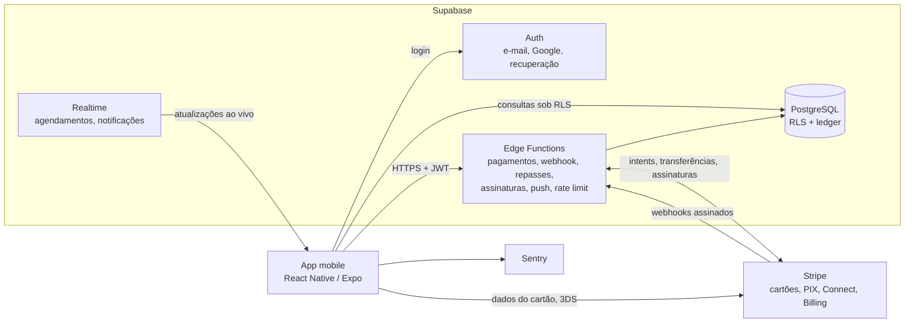

# Wall to All · Marketplace de serviços locais, do agendamento ao repasse

App mobile de dois lados que conecta pessoas a prestadores de serviços locais (salões, barbearias e outros pequenos negócios). Os clientes encontram um estabelecimento, agendam um horário ou entram na fila ao vivo e pagam com cartão ou PIX. Os comerciantes gerenciam agenda, serviços, fila, finanças e conteúdo no mesmo app. Construí tudo de ponta a ponta como desenvolvedor principal do projeto na Kavicki: o app mobile, o backend em Supabase e a integração de pagamentos.

**Status:** Em fase final antes do lançamento.

> Este repositório é um estudo de caso, não um repositório de código. O código-fonte pertence ao cliente e continua privado. Tudo o que está aqui descreve o meu próprio trabalho, em um nível de detalhe que posso aprofundar em entrevista.

---

## Visão geral

| | |
|---|---|
| **Meu papel** | Desenvolvedor principal: app mobile, backend em Supabase (banco de dados, políticas de segurança, funções de servidor), pagamentos, builds |
| **Período** | Novembro de 2025 a novembro de 2026 (primeira versão até janeiro de 2026, escopo ampliado a partir de julho de 2026) |
| **Status** | Em fase final antes do lançamento |
| **Stack** | React Native 0.81 / Expo 54, Expo Router 6, React 19, TypeScript, Supabase (Auth, PostgreSQL com Row Level Security, Realtime, Edge Functions), Stripe (cartões, PIX, Connect, Billing), Sentry, EAS Build |
| **Código** | 82 arquivos de rota · 11 funções de servidor · 8 migrations SQL · 1.012 casos de teste automatizados |

## O problema

Pequenos negócios de serviços no Brasil costumam controlar a agenda no papel ou no WhatsApp. O cliente não consegue ver os horários livres nem pagar antecipado, e quem chega sem hora marcada não faz ideia de quanto vai esperar.

O Wall to All precisava funcionar para os dois lados:

- **Clientes** buscam estabelecimentos próximos, agendam um serviço em um horário livre, pagam com cartão ou PIX (ou no local), entram em uma fila ao vivo quando querem ser atendidos no mesmo dia e acompanham seus agendamentos.
- **Comerciantes** gerenciam serviços e preços, confirmam e remarcam agendamentos, tocam uma fila presencial, acompanham a receita em relação a uma meta mensal, sacam o que ganharam e publicam fotos e vídeos para atrair clientes.

Com pagamentos no escopo, as partes difíceis passaram a ser as que o usuário nunca vê: um agendamento nunca pode ser cobrado duas vezes, um agendamento pago nunca pode sumir e cada centavo no saldo do comerciante precisa ter explicação.

## Restrições

- **Equipe.** Um desenvolvedor no produto (eu). Telas e componentes vieram da equipe de design da Kavicki no Figma. As regras de negócio foram definidas com o cliente.
- **Cliente.** Vários valores de negócio (tarifa da plataforma, preço para avançar na fila, cashback de indicação) ainda estavam em aberto enquanto o produto era construído, então precisavam ficar configuráveis em vez de fixos no código.
- **Prazo.** Uma primeira versão com agendamento e gestão do negócio (novembro de 2025 a janeiro de 2026), depois um escopo maior entregue em nove fases planejadas entre julho e novembro de 2026.
- **Plataformas.** Android primeiro, com o projeto nativo versionado no repositório. O iOS é configurado pelo Expo. Contexto brasileiro em tudo: PIX, BRL, interface em português, validação de CPF/CNPJ/CEP.

## O que construí

**App do cliente**
- Descoberta: home com stories e estabelecimentos em destaque, busca com resultados, perfil da loja e avaliações.
- Agendamento: serviço, horário e confirmação, com pagamento por cartão, PIX ou no local. Histórico de agendamentos, detalhes e remarcação.
- "Aqui e Agora": mapa de estabelecimentos próximos, lista de espera ao vivo com a posição do cliente, tela de ticket e opção paga para avançar na fila.
- Carteira com cartões salvos, chaves PIX e extrato. Programa de indicação com cashback (QI), com ganhos, código para compartilhar, indicados e saques.
- Feed de posts com fotos e vídeos dos estabelecimentos.

**App do comerciante**
- Home com meta mensal, cards de KPI e receita por serviço, calendário do mês e tela de métricas.
- Agendamentos: confirmar, remarcar e acompanhar cada solicitação.
- Serviços e preços, perfil do negócio com selos, gestão da fila presencial e configurações.
- Finanças: saldo, extrato, onboarding da conta de recebimento e saques. Assinatura mensal da plataforma.
- Publicação no feed pela câmera (foto, ou vídeo de até 30 segundos), com prévia e serviço vinculado.

**Contas e plataforma**
- E-mail e senha, login com Google por deep link, recuperação de senha, cadastro em várias etapas separado para clientes e comerciantes, roteamento por perfil, exclusão de conta.
- Notificações push, rate limiting, telas de privacidade e legais, relatório de crashes com Sentry.

**Backend e pagamentos**
- Supabase PostgreSQL com Row Level Security (RLS), migrations versionadas e scripts de teste SQL para as regras de pagamento.
- Edge Functions para pagamentos, cartões salvos, webhook da Stripe, onboarding de comerciantes, saques, assinaturas, notificações push, rate limiting e exclusão de conta.
- Ledger que registra cada crédito, tarifa, reembolso e saque, de modo que os saldos são calculados, nunca digitados.

## Arquitetura

- Toda tela fala com uma interface de serviço (carteira, pagamentos de agendamento, fila, indicação, feed, assinatura), nunca diretamente com um provedor. Cada interface tem uma implementação em memória para testes e para o início do trabalho de UI, e uma real atrás de um seletor na raiz do app (ver [ADR 0001](docs/adr/0001-ui-primeiro-atras-de-interfaces-de-servico.md)).
- A chave secreta de pagamento fica só nas Edge Functions. O app guarda apenas a chave publicável, e a configuração do app se recusa a fazer o build se uma chave secreta chegar até ela.
- Um pagamento só aparece como "aprovado" na UI quando o banco diz que foi, e quem escreve no banco é o webhook assinado da Stripe (ver [ADR 0002](docs/adr/0002-webhook-como-fonte-de-verdade.md)).
- O dashboard do comerciante e as notificações escutam o Supabase Realtime, então um novo agendamento aparece sem precisar atualizar a tela.

## Principais decisões e trade-offs

| Decisão | Alternativas consideradas | Por quê | Custo aceito |
|---|---|---|---|
| Construir toda tela nova primeiro contra interfaces de serviço mockadas e depois conectar os backends reais ([ADR 0001](docs/adr/0001-ui-primeiro-atras-de-interfaces-de-servico.md)) | Construir cada funcionalidade junto com o backend | Cerca de 60 telas novas puderam avançar com o provedor de pagamento ainda indefinido | Duas implementações por domínio, mantidas em paridade pelos testes |
| O webhook da Stripe é o único que escreve o status do pagamento ([ADR 0002](docs/adr/0002-webhook-como-fonte-de-verdade.md)) | Confiar no callback de sucesso do app | Um app fechado, uma conexão perdida ou um evento reenviado nunca conseguem criar nem perder um pagamento | O app precisa fazer polling do resultado em vez de reagir na hora |
| Reservar o horário primeiro e cobrar depois ([ADR 0003](docs/adr/0003-reservar-e-depois-cobrar.md)) | Cobrar primeiro e criar o agendamento depois | Uma falha de escrita depois de uma cobrança bem-sucedida deixaria dinheiro sem agendamento | Por um curto período, o comerciante pode ver um agendamento reservado que ainda não foi pago |
| A plataforma retém os fundos e o saque vira transferências ([ADR 0004](docs/adr/0004-plataforma-retem-fundos-saques-viram-transferencias.md)) | Pagar o comerciante dentro de cada cobrança e disparar repasses sob demanda | Repasses manuais não são permitidos para contas conectadas brasileiras, como o teste mostrou | Cada transferência precisa apontar para uma cobrança de origem, então os saques exigem uma etapa de alocação |

## Desafios

### 1. Deep link de redefinição de senha confiável com o app aberto ou fechado

**Sintoma.** Em dezembro de 2025, nos builds de piloto, o link de redefinição do e-mail de recuperação nem sempre levava o usuário à tela de redefinição. O guard de rotas do app via uma sessão autenticada sem perfil e mandava o usuário para a tela de seleção de perfil, ou mostrava um alerta de "erro de perfil". Quando o link reiniciava o app, às vezes a URL de entrada ainda não estava disponível. Links expirados chegavam com um erro em vez de tokens e não eram tratados.

**Por que foi difícil.** Três coisas reagiam ao mesmo link ao mesmo tempo: o Supabase colocando os tokens de sessão na URL, o Expo Router tratando o deep link e o guard global de autenticação redirecionando os usuários. O comportamento dependia de timing e de o app estar fechado ou já aberto, e só reproduzia em um aparelho real com um e-mail real.

**O que fiz.** Uma allow-list para o guard deixar a rota de redefinição em paz, uma flag que marca a sessão de recuperação para o app pular a consulta do perfil e, para o caso de reinicialização, um listener global de links no layout raiz, uma janela curta de retry para a URL inicial, o logout de qualquer sessão anterior antes de aplicar os tokens de recuperação e a leitura dos códigos de erro do Supabase, para que um link expirado mostre "solicite um novo link". Também cobri a sessão já aberta e o erro de "a nova senha precisa ser diferente".

**O que resolveu.** Tratar a recuperação como um tipo próprio de sessão, com regra de roteamento própria e tratamento explícito de links expirados ou inválidos. Depois movi o roteamento e o tratamento de links do layout raiz para hooks dedicados (22 de dezembro) e, mais tarde, para um módulo pequeno com um parser, um processador de tokens e flags de sessão (julho de 2026). Esse último passo trocou um arquivo de 604 linhas de tratamento de links por um ponto de entrada de 24 linhas.

### 2. Validar o modelo de repasse antes de escrever o servidor

O design de pagamentos assumia que a parte do comerciante iria para a conta conectada dele dentro de cada cobrança, e que um saque dispararia um repasse sob demanda para o banco. Como o comportamento do provedor no Brasil era incerto, a primeira tarefa do plano foi um teste no sandbox do provedor antes de escrever qualquer código de servidor. O teste mostrou que repasses sob demanda não são permitidos para contas conectadas brasileiras e que toda transferência precisa de uma cobrança de origem. No mesmo dia mudei o modelo: a plataforma retém os fundos, o ledger credita o comerciante e um saque vira uma ou mais transferências alocadas às cobranças desse comerciante. Detalhes no [ADR 0004](docs/adr/0004-plataforma-retem-fundos-saques-viram-transferencias.md). A tela de saque manteve o design, e só o prazo de entrega prometido mudou.

### 3. Revisão de segurança antes de ampliar o escopo

Em julho de 2026, antes de começar o novo escopo com dinheiro real, conduzi uma revisão de segurança do backend: reforcei a autorização das funções de servidor e as regras de storage e fixei o search path das funções do banco. Toda mudança de schema sai como migration versionada, e as regras de pagamento têm scripts de teste SQL que rodam dentro de uma transação com rollback.

## Do design ao código

A equipe de design da Kavicki entregou as telas e a biblioteca de componentes no Figma. Implementei primeiro os componentes compartilhados e depois compus as telas sobre eles, cada uma com todos os estados (vazio, carregando, cheio e erro) e conferida contra o design.

## Resultados

- Entreguei uma primeira versão com agendamento e gestão do negócio (builds de piloto em dezembro de 2025) e depois um escopo maior, com fila ao vivo, carteira, programa de indicação, feed, assinatura e pagamentos reais, de julho a novembro de 2026.
- Pagamentos, cartões salvos, onboarding de comerciantes, saques e assinaturas integrados à Stripe e validados de ponta a ponta, incluindo 3DS, cartões recusados, renovações e reenvios de webhook.
- 1.012 casos de teste automatizados em 110 suítes, todos passando, e CI que roda typecheck, lint e testes em todo push e pull request para a branch principal.

## Próximos passos

- Lançamento público, com a mesma base de testes e CI protegendo cada mudança.
- Valores de negócio (tarifa da plataforma, preço para avançar na fila, cashback) já configuráveis, prontos para ajustes do cliente sem novo deploy de código.

## Como trabalho

Fui dono deste produto de ponta a ponta. Transformei as necessidades do cliente em especificações, projetei o modelo de dados e os fluxos de pagamento, tomei as decisões de segurança e levei o app da primeira tela até a fase final antes do lançamento.

Meu processo foi montado para manter a qualidade alta entregando como desenvolvedor principal:

- **Especificação primeiro.** Toda fase começa com um plano de implementação, e a maioria também com um documento de design, que eu escrevo e aprovo. O repositório guarda 17 desses documentos, incluindo um documento mestre com as decisões, a ordem das fases e os riscos. Questões de negócio em aberto ficam listadas com o valor usado até o cliente decidir.
- **Testes como rede de segurança.** As telas são construídas com testes primeiro. Um hook de pre-push roda typecheck e lint, e o CI roda typecheck, lint e os 1.012 casos de teste em todo push e pull request. As regras de pagamento também têm scripts de teste SQL.
- **Assistido por IA, sob minha responsabilidade.** Uso agentes de código para acelerar a implementação de tarefas que já especifiquei no plano. Reviso cada diff, rejeito o que não segue o design e mantenho arquitetura, modelagem de dados, segurança e lógica de pagamento sob meu controle direto.
- **Um pull request por fase.** Cada fase entra pelo próprio pull request, junto com o documento de design e o plano.
- **Operação segura.** Chaves secretas nunca passam pelo app nem pelo repositório: vão direto para os secrets das funções de servidor. O plano de pagamentos termina com uma varredura do repositório em busca de chaves vazadas antes do merge.

## Equipe e créditos

- **Design:** telas e biblioteca de componentes fornecidas prontas para uso pela equipe de design da Kavicki no Figma. Construí o app inteiro sobre elas, de ponta a ponta: todas as telas e fluxos, navegação, estado e camada de dados, backend, pagamentos e builds.
- **Produto:** prioridades e regras de negócio foram definidas junto com o cliente.
- **Builds:** um colega contribuiu com a configuração inicial de build do EAS.

## Por que não há código aqui

O código pertence ao cliente. Em uma entrevista técnica, posso percorrer qualquer parte do sistema, incluindo modelos de dados, fluxos de pagamento e o modelo de segurança, dentro dos limites desse acordo.

---

Contato: [LinkedIn](https://www.linkedin.com/in/gabriel-souza-fernandes/) · [GitHub](https://github.com/Fergab1)
